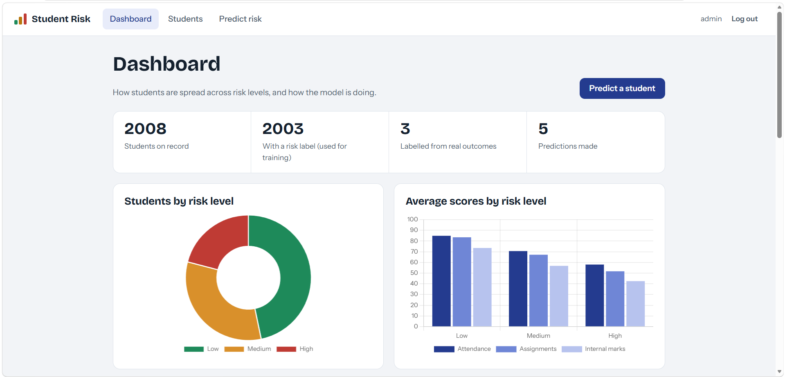
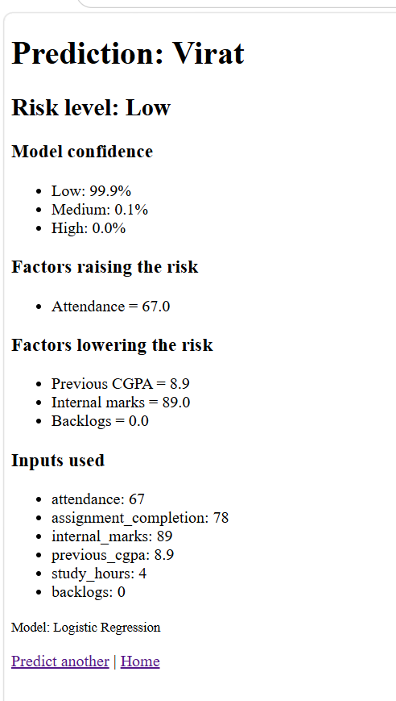
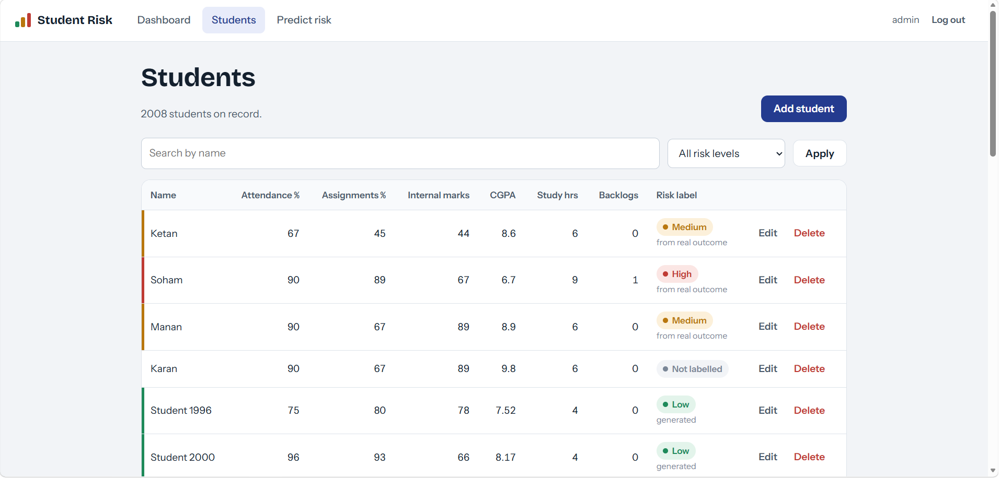
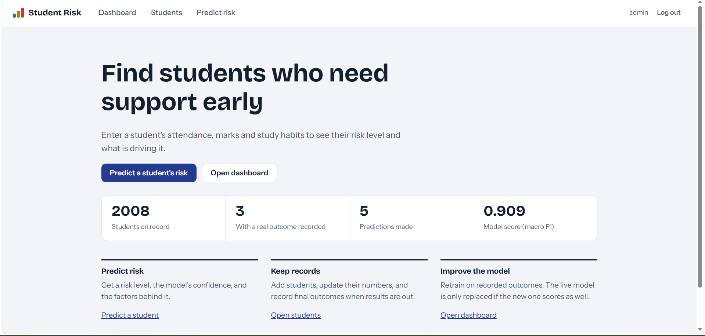

# Smart Student Performance Analytics and Risk Prediction System

A Django web app that stores student data in MongoDB, trains a machine-learning model on it,
and predicts whether a student is at **Low**, **Medium** or **High** academic risk.

> **Data note:** the 2,000 training students are **synthetic**, generated by
> `ml/generate_sample_data.py` with a rule-based risk score plus noise. Model scores therefore
> show that the pipeline works, not how well it would predict real students. Real students can be
> added and given a real outcome, and retraining includes them.

## Architecture

```
Browser -> Django (views, forms, auth) -> MongoDB (students, predictions, training_runs)
                          |
                          +-> ml/predict.py -> model.pkl (trained offline)

Retrain button -> ml/training.py -> compare 7 models -> promote only if not worse -> log run
```

## Features

- Student CRUD stored in MongoDB (add, list, edit, delete)
- Risk prediction with probabilities and the top factors raising or lowering the risk
- Dashboard built from MongoDB aggregation pipelines, with Chart.js charts
- Login-protected pages, with retraining restricted to staff accounts
- Retraining that compares 7 models with 5-fold cross-validation and replaces the live model
  only if the new one scores at least as well on the same test set
- A training log in MongoDB, and a backup of the previous model
- Real outcomes can be recorded per student and used as training labels
- 31 automated tests that run against a throwaway database

## Model comparison

5-fold cross-validation on the training split (about 1,600 students, synthetic data):

| Model | Accuracy | Macro F1 | High recall |
|---|---|---|---|
| Logistic Regression | 0.909 | 0.905 | 0.934 |
| SVM | 0.906 | 0.902 | 0.925 |
| Gradient Boosting | 0.899 | 0.895 | 0.899 |
| KNN | 0.899 | 0.894 | 0.890 |
| Random Forest | 0.899 | 0.893 | 0.887 |
| Naive Bayes | 0.895 | 0.890 | 0.845 |
| Decision Tree | 0.848 | 0.844 | 0.881 |

Figures come from one training run. Each successful retrain rewrites ml/model_comparison.csv, and the numbers can move by a few thousandths.

Logistic Regression was selected: it ranked first on macro F1 and High-class recall, and it gives
per-student explanations. It performs well partly because the synthetic labels come from a
weighted sum of the features, which a linear model fits naturally. On the held-out test set
(about 400 students) it reached macro F1 0.909.


## Setup (Windows)

1. Install Python 3.10+, Git and MongoDB Community Server (with Compass).
2. Create and activate a virtual environment, then install the dependencies:
```
   python -m venv venv
   venv\Scripts\activate
   pip install -r requirements.txt
```
3. Copy `.env.example` to `.env` and set `DJANGO_SECRET_KEY`. Generate one with:
```
   python -c "from django.core.management.utils import get_random_secret_key as g; print(g())"
```
4. Create the login tables and an admin user:
```
   python manage.py migrate
   python manage.py createsuperuser
```
5. Generate the sample data and train the model:
```
   python -m ml.generate_sample_data
   python -m ml.train_model
```
6. Run the app and open http://127.0.0.1:8000/:
```
   python manage.py runserver
```

Run the tests with `python manage.py test`.

## Project structure

```
manage.py
student_risk_prediction/   Django settings and root URLs
students/                  app: views, forms, templates, MongoDB helpers, tests
ml/                        data loading, EDA, training, prediction, sample-data generator
ml/model_comparison.csv    latest model comparison
```

`ml/model.pkl` is a build output and is not in the repository. Create it with
`python -m ml.train_model`.

## Limitations

- Training data is synthetic, so reported accuracy is not a real-world estimate.
- Retraining runs inside the web request, which is fine at this size. A larger system would use
  a background job.
- The model is only as good as the labels. Real outcome labels need to be collected over time.

## Screenshots




